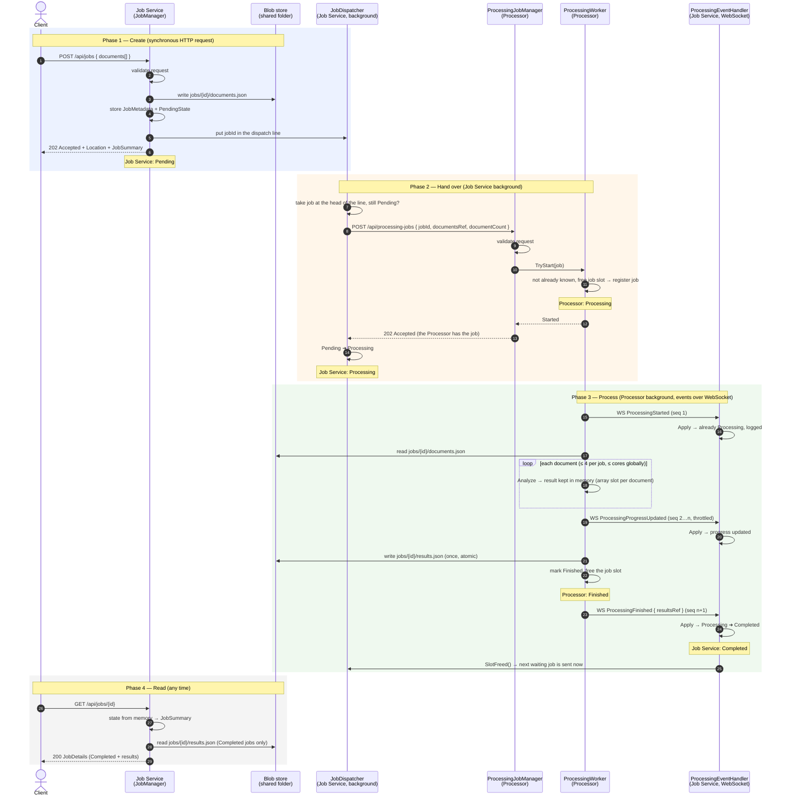

# Happy Flow

One job, from the client's POST to `Completed`, with nothing going wrong. The failure paths are in [PLAN.md](PLAN.md#reliability).

**Who decides what:** the Job Service decides only what happens before the handover (waiting in line). Once the Processor accepts the job, the Job Service records what the Processor reports. The Processor *finishes* its work; the Job Service marks the job *Completed* when it receives that report.

## State on each side

| Moment | Processor (`ProcessingStatus`) | Job Service (`JobStatus`, what `GET` returns) |
|---|---|---|
| right after POST (step 6) | — (doesn't know the job yet) | `Pending`, 0 / N processed |
| Processor accepted the job (step 11) | `Processing` | `Pending` (202 not received yet) |
| dispatcher got the 202 (steps 13–14) | `Processing` | `Processing`, 0 / N |
| `ProcessingProgressUpdated` applied (steps 19–20) | `Processing` | `Processing`, k / N |
| Processor done (steps 21–23) | `Finished` | `Processing` (event on its way) |
| `ProcessingFinished` applied (step 24) | `Finished` | **`Completed`**, N / N, results readable |

`ProcessingStarted` and the dispatcher's 202 can arrive in either order: whichever comes first moves the job to Processing, and the other is a no-op (but still logged).

## Who talks to whom

| From → To | Channel | Carries |
|---|---|---|
| Client → Job Service | REST | the documents (validated, then stored as a blob) |
| Job Service → Processor | REST | `jobId` + `documentsRef` only (claim-check); cancel commands |
| Processor → Job Service | WebSocket | processing events with metadata only (counts, `resultsRef`) |
| Both services ↔ blob store | shared folder | `documents.json` (written by the Job Service), `results.json` (written by the Processor, read by the Job Service on demand) |
