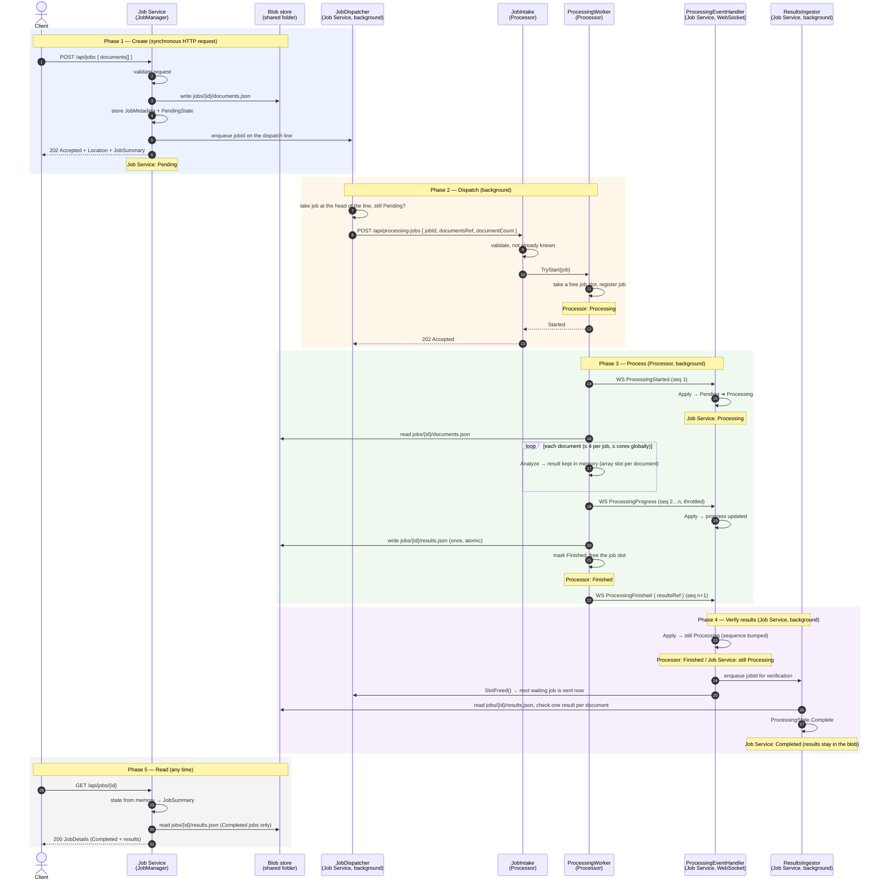

# Happy Flow

One job, from the client's POST to `Completed`, with nothing going wrong. The failure paths are in [PLAN.md](PLAN.md#reliability).

**Vocabulary:** the Processor *finishes* its work. The Job Service *completes* the job, after it has verified the results. These are two different moments.

## State on each side

| Moment | Processor (`ProcessingStatus`) | Job Service (`JobStatus`, what `GET` returns) |
|---|---|---|
| right after POST (step 6) | — (doesn't know the job yet) | `Pending`, 0 / N processed |
| Processor accepted the job (step 11) | `Processing` | `Pending` (event not arrived yet) |
| `ProcessingStarted` applied (steps 14–15) | `Processing` | `Processing`, 0 / N |
| `ProcessingProgress` applied (steps 18–19) | `Processing` | `Processing`, k / N |
| Processor done (steps 21–23) | **`Finished`** | **`Processing`**, N / N |
| results verified (steps 26–27) | `Finished` | **`Completed`**, N / N, results readable |

## Who talks to whom

| From → To | Channel | Carries |
|---|---|---|
| Client → Job Service | REST | the documents (validated, then stored as a blob) |
| Job Service → Processor | REST | `jobId` + `documentsRef` only (claim-check) |
| Processor → Job Service | WebSocket | processing events with metadata only (counts, `resultsRef`) |
| Both services ↔ blob store | shared folder | `documents.json` (written by the Job Service), `results.json` (written by the Processor, read by the Job Service on demand) |
